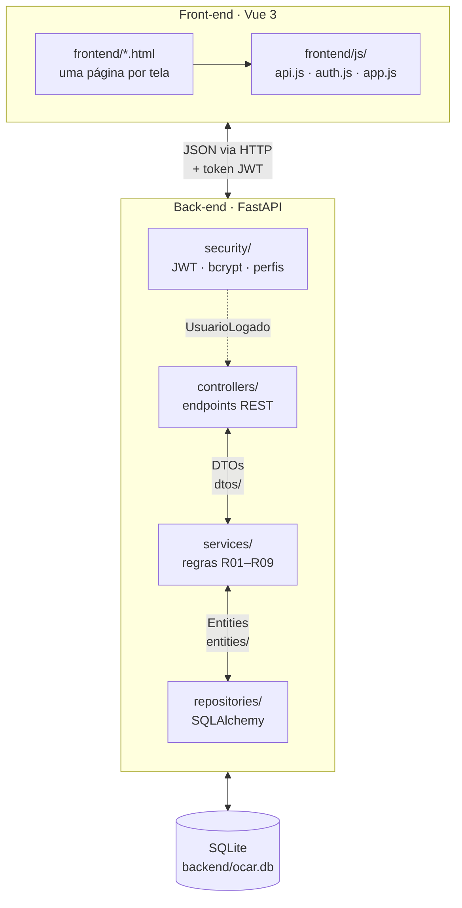

# OCar – Gerenciamento de Locações

Avaliação Prática (Aproveitamento de Estudos) – Parte I.

| Camada    | Tecnologia                                          | Pasta       |
|-----------|-----------------------------------------------------|-------------|
| Front-end | Vue 3 (sem build, arquivos `.html`) + Bootstrap 5   | `frontend/` |
| Back-end  | Python + FastAPI + SQLAlchemy + JWT                 | `backend/`  |
| Banco     | SQLite (`backend/ocar.db`, criado automaticamente)  |             |

## Arquitetura



- **Front-end**: cada tela é um `.html` com Vue; `api.js` faz as requisições com o token, `auth.js` guarda a sessão.
- **Controller** recebe e devolve **DTOs** e chama o service passando o `usuario.id` do token (`UsuarioLogado`).
- **Service** aplica as regras R01–R09, converte DTO ↔ **entidade** e usa os repositories.
- **Repository** só acessa o banco.
- Erros de regra viram `{"detail": "mensagem"}`, que o front mostra no alerta da página.
- O `tests/test_camadas.py` falha se um controller importar entidade/repository ou um service importar FastAPI.

## Como rodar

Pré-requisito: Python 3.11+.

**1. Back-end** (porta 8080)

```bash
cd backend
python3 -m venv .venv
source .venv/bin/activate
pip install -r requirements.txt
uvicorn app.main:app --port 8080 --reload
```

Swagger para testar a API: http://localhost:8080/docs (funciona sem internet)

**2. Front-end** (porta 5500, em outro terminal, na raiz do projeto)

```bash
python3 frontend/servidor.py
```

Abrir http://localhost:5500/login.html

**Testes**

```bash
cd backend && .venv/bin/pytest                    # back-end: regras, permissões, token, modelo, camadas e coleção do Insomnia
node --test frontend/tests/frontend.test.js       # front-end: auth.js, api.js, app.js e páginas, inclusive se o HTML/JS de cada página compila (na raiz)
```

Roteiro para testar tudo à mão (Insomnia + navegador): [`manual-testes.md`](manual-testes.md).

**Resetar o banco:** pare o back-end, apague `backend/ocar.db` e suba de novo (as tabelas são recriadas vazias).
Faça isso antes de rodar a coleção do Insomnia (ela espera ids começando em 1) e depois de alterar uma entity.

## Estrutura

```
backend/app/
  main.py          app FastAPI, CORS, tratamento de erros, registro dos controllers, Swagger (/docs)
  config.py        URL do banco, chave e expiração do JWT
  database.py      engine/sessão do SQLAlchemy
  exceptions.py    erros de negócio -> {"detail": mensagem}: NegocioException (400), CredenciaisInvalidas (401),
                   AcessoNegado (403), NaoEncontrado (404), Conflito (409)
  entities/        modelo de dados (Usuario, Veiculo, Locacao, Perfil, Situacao)
  dtos/            RequestDTO / ResponseDTO (Pydantic)
  repositories/    acesso ao banco
  services/        regras de negócio R01–R09
  controllers/     endpoints REST
  security/        JWT, hash de senha (bcrypt), usuario_logado / exigir_perfil -> UsuarioLogado(id, login, perfil)
backend/static/    arquivos do Swagger, para o /docs funcionar sem internet
backend/tests/     um arquivo por assunto (usuarios, veiculos, locacoes, permissoes, seguranca, modelo, camadas, documentacao, insomnia)

frontend/
  *.html           uma página por tela (login, usuario, menu, meusdados, veiculos, gerenciarlocacoes, minhaslocacoes)
  js/api.js        chamadas HTTP (api.get/post/patch/delete) com token e mensagens de erro
  js/auth.js       sessão: token, usuário logado (lido do JWT), exigir perfil, sair
  js/app.js        criarApp(): cabeçalho, rodapé e formatadores comuns a todas as páginas
  css/style.css    estilos próprios
  vendor/          Vue, Bootstrap e Bootstrap Icons (funciona offline)
  tests/           testes do front (node, sem npm)
  servidor.py      serve o front sem cache
```


## Onde mexer

Passo a passo com código pronto (campo novo, tela nova, entidade nova, select, busca, regras, permissões) e explicação do Vue para quem sabe Python: [`guia-alteracoes.md`](guia-alteracoes.md).

| Quero...                     | Back-end                                                                 | Front-end                                                          |
|------------------------------|--------------------------------------------------------------------------|--------------------------------------------------------------------|
| Adicionar um campo           | entity + DTOs + montagem no service; apagar `ocar.db`                    | input no form, coluna na tabela, incluir no `api.post/patch`       |
| Nova regra de negócio        | service: `raise NegocioException("mensagem")` (400) ou `ConflitoException`, `NaoEncontradoException`... | nada: a mensagem já aparece no alerta da página |
| Novo endpoint                | controller → service → repository (rotas fixas antes de `/{id}`)         | `await api.get('/rota')` na página                                 |
| Mudar quem acessa            | `Depends(exigir_perfil(Perfil.X))` ou `usuario_logado` no controller     | `perfis: [...]` no `criarApp` da página e no item do menu          |
| Nova tela                    | —                                                                        | copiar uma página parecida + uma linha no array `itens` do `menu.html` |
| Mudança visual em todas      | —                                                                        | `js/app.js` (cabeçalho/rodapé) ou `css/style.css`                  |

Exemplo – campo `cor` no veículo:

1. `entities/veiculo.py`: `cor: Mapped[str] = mapped_column(String(30))`
2. `dtos/veiculo_dto.py`: `cor: str` no `VeiculoRequestDTO` e no `VeiculoResponseDTO`
3. `services/veiculo_service.py`: `Veiculo(..., cor=dto.cor)`
4. Apagar `backend/ocar.db`
5. `veiculos.html`: `<th>Cor</th>` + `<td>{{ veiculo.cor }}</td>`, input `v-model="form.cor"` e `cor: this.form.cor` no `api.post`
6. Testes: `"cor": "Prata"` no `corpo_veiculo` de `tests/dados.py` e `cor` nas listas de campos de `tests/test_modelo.py`

Os testes conferem o modelo, os DTOs e o menu **exatamente** como no enunciado da Parte I. Quando o professor pedir
uma mudança nessas partes, os testes correspondentes vão falhar: atualize-os junto com a mudança.
Um campo novo **obrigatório** também faz o `test_insomnia.py` falhar, porque a coleção da Parte I não envia o campo.
É um aviso real: a coleção original deixaria de funcionar.

Erros de JavaScript e avisos do Vue aparecem no console do navegador (F12).
